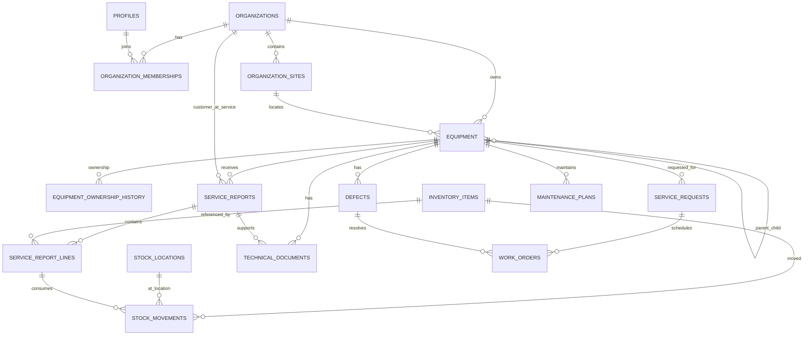

# HydraRoll Management App — Foundation and Migration Plan

**Status:** Foundation milestone in progress. No Supabase, GitHub, or Vercel service has been created or connected. No DNS or public deployment has been performed.

## Existing prototype inspection

The preserved reference is `../outputs/Heavy-Transport-Service-Sheets.html` with `../outputs/hr-logo.png`.

It is a single-page HTML/CSS/JavaScript application with a separate landing menu and three work areas:

- **Service Sheets:** six source checklist variants—Goldhofer conventional, Goldhofer gooseneck, Scheuerle, Nooteboom, PPU, and reconfiguration. Rows support O/C/R/N/A and comments. Applicable sheets include ALB min/max readings and ball-valve pass/fail rows with repair notes. It also captures customer/equipment details, reference, service interval, parts, findings, work status, customer notification, follow-up, signatures, and print/PDF output.
- **Inventory / Stocks:** part number, description, quantity, local stock list. Saving a service sheet deducts selected inventory quantities; editing adjusts the difference and deleting the service sheet restores the quantity.
- **Files:** file name, category, equipment/VIN, notes, upload, download, delete, search and device share where supported.

Service sheets and stock use browser `localStorage`; documents use browser IndexedDB. The prototype has no server, login, shared database, cloud files, central audit trail, or cross-device synchronisation. The complete checklist data has been copied to `src/data/checklists.json`. The standalone prototype is not being removed or overwritten.

## A. Proposed application folder/module architecture

```text
hydraroll-management-app/
  public/                 PWA icon and HydraRoll logo
  src/
    app/                   App shell, role-aware navigation, session gate
    components/            Shared form controls, signatures, banners
    modules/
      service-sheets/       Existing inspection templates and report workflow
      inventory/            Stock list and ledger views
      files/                Private document library
      equipment/            Asset register and QR landing pages (later milestone)
      customers/            Organisations, sites and customer portal (later)
      defects/              Defect intake and close-out (later)
      work-orders/          Requests, scheduling and work orders (later)
      maintenance/          Maintenance plans and reminders (later)
    lib/
      supabase/             Client, auth, data adapters and storage adapters
      offline/              Local drafts, upload queue and sync reconciliation
    data/                   Migrated checklists and local preview fixtures
  supabase/
    migrations/             Versioned Postgres schema and RLS policies
    tests/                  Cross-organisation RLS and business-rule checks
  docs/                     Architecture, permission and migration decisions
```

Vite builds the static app; React modules own separate screens and data adapters. Supabase is the authority for hosted data. The browser-only adapters are for prototype continuity and offline drafts, not the long-term shared record.

## B. Entity relationship diagram and initial schema



The initial SQL migration creates the organisation and membership foundation, sites, durable equipment IDs and ownership history, service reports and lines, inventory catalogue, locations and append-only stock movements, technical document metadata, defects, service requests, work orders, maintenance plans, activity events, and user notifications. Report payload JSONB preserves the different supplied checklist layouts while report line items remain relational. Customer report visibility is tied to the commissioning organisation and explicit approval fields, not the equipment's current owner.

Stock on hand is derived from signed movements. A unique idempotency key prevents a retry from applying the same movement twice. Corrections are explicit, reasoned, and linked to the movement they reverse. The full server-side posting function and operational workflows are scheduled for the inventory/service workflow milestone; the migration does not yet expose unrestricted movement writes.

## C. Permission matrix

| Capability | Platform admin | Internal manager | Technician | Customer admin | Customer user |
|---|---|---|---|---|---|
| Manage organisations, platform roles, and all data | Yes | No | No | No | No |
| Manage users in assigned customer organisation | Yes | Internal support | No | Yes, customer roles only | No |
| Read internal operational records | Yes | Assigned internal org | Assigned internal org | No | No |
| Manage equipment register and ownership | Yes | Yes | Service updates only | No | No |
| Create/edit service report drafts | Yes | Yes | Yes, assigned work | No | No |
| Review, approve, and issue reports | Yes | Yes | No | No | No |
| View issued, approved customer-visible history | Yes | Yes | Yes | Assigned organisation | Assigned organisation |
| Manage inventory catalogue/locations | Yes | Yes | Read/use for assigned work | No | No |
| Post/correct stock movements | Yes | Yes, with reason/audit | Issue/return via work flow | No | No |
| Submit defect/service request | Yes | Yes | Yes | Yes | Yes |
| Triage/assign/close defects and work orders | Yes | Yes | Assigned work only | No | No |
| Read customer-approved documents | Yes | Yes | Yes | Own organisation | Own organisation |
| Upload customer evidence | Yes | Yes | Yes | Own organisation | Own organisation |
| Approve customer-visible documents | Yes | Yes | No | No | No |

RLS is enabled on every application table in the initial migration. Policies use active organisation memberships; the customer-report policy limits customer users to approved/issued and explicitly customer-visible reports. The customer-facing UI is not being opened in this foundation milestone. Cross-organisation policy tests are a release gate before connecting a real Supabase project.

Membership changes are platform-admin-only in this foundation migration. The permission matrix's customer-admin user-management capability must be implemented through verified invitations before it is enabled; direct membership writes by customer admins are deliberately not granted yet.

## D. UI navigation

**Internal landing page:** Service Sheets · Inventory / Stocks · Files. Later tiles: Equipment, Defects, Work Orders, Maintenance, Customers, Reports, Staff Administration.

**Customer landing page:** My Equipment · Approved Service History · Documents · Report a Defect · Request Service. Customer users do not receive the internal inventory, staff, or work-order menus. The first foundation build keeps this portal behind an explicit “next milestone” screen and does not expose customer data.

## E. Migration plan preserving current behavior

1. Preserve the standalone HTML prototype and brand assets; migrate source data, not user browser storage, into React modules.
2. Copy the exact checklist definition to typed data. Keep each checklist type and ball-valve/ALB applicability rule distinct.
3. Port service sheet fields, status/comments, signatures, parts, notes, and print layout. Generate report numbers server-side when hosted; the local preview continues a local sequence.
4. Port the parts catalogue and service-sheet usage relationship. In hosted mode, replace direct quantity mutation with an idempotent stock movement transaction and visible movement history.
5. Port file categories/search and metadata. Hosted documents go to a private bucket; browser local documents remain a temporary local-preview mode.
6. Before importing real records, agree a permanent asset ID and map existing VIN/rego, model, customer, service reference, dates, checklist results, parts and file metadata. Keep the original spreadsheet records as the source archive.
7. Use a dry-run import and record-count/reconciliation report before any production import. No existing prototype localStorage/IndexedDB data is automatically migrated by this foundation.

## F. Milestones and acceptance tests

| Milestone | Scope | Acceptance tests |
|---|---|---|
| 0. Inspection and decisions | Document existing behavior, roles, entities, privacy and migration | Prototype remains unchanged; all six checklist variants match source names/sections; no deployment/service created |
| 1. React foundation (current) | Vite/React/TypeScript, responsive shell, PWA shell, module boundaries, local preview migration | Typecheck/build pass; checklist/status/repair/part/signature/print smoke tests pass on laptop and narrow mobile viewport; app shell opens offline; no Supabase credentials required |
| 2. Supabase security foundation | Create project only after approval; apply migrations; provision pilot users and organisations; test RLS | Platform admin/internal manager/technician/customer admin/customer user tests; user in Org A cannot read Org B records/files; inactive users denied; service secrets absent from client bundle |
| 3. Hosted migration | Data adapters, service reports, inventory ledger, private files, dry-run import | No duplicate report refs; report saves are atomic; repeated stock request with same idempotency key moves stock once; corrections are auditable; restricted files require signed access |
| 4. Equipment and customer portal | Equipment hierarchy/ownership, QR route, approved history, customer reports | QR opens the right asset page but confers no access; ownership changes do not reassign old reports; customer access follows report-level approval and organisation scope |
| 5. Operations | Defects, service requests, work orders, maintenance plans, reminders, notifications, reporting | Defect closure requires an authorised documented decision; work order completion cannot imply return-to-service; reminders respect plan intervals and timezone |
| 6. Offline-first field work | Local draft/photo queue, sync status, retries, conflict review | Airplane-mode inspection survives app close/reopen; queued photos persist; retries are idempotent; conflicts are shown for explicit resolution; sync confirmation is visible |
| 7. Integrations and release | Shopify evaluation, UAT, backup/restore drill, private Vercel preview, DNS approval | UAT sign-off; backup restore verified; only `app.hydraroll.com.au` is mapped after approval; existing apex/website records remain unchanged |

Stage 1 automated checks passed during foundation work: 4 local data-rule tests, TypeScript project build/typecheck, and a production Vite/PWA build. In this Windows sandbox the pnpm launcher itself fails while trying to register a workspace symlink, so the installed Vitest, TypeScript, and Vite binaries were run directly. Manual device/print/offline smoke checks remain a follow-up. Supabase RLS checks require a local Supabase test database and seeded multi-organisation users; they must pass before a real project contains customer data.

## G. Technical risks and decisions

- **Ownership and historical visibility:** confirm whether a former owner can see reports created while it owned the asset. The schema preserves the commissioning customer organisation; the default policy is that only that organisation sees an approved report.
- **Permanent asset ID:** confirm the asset ID pattern and label process. QR codes should encode a hosted equipment route keyed by permanent asset ID; scanning does not authorise access.
- **Staff identity:** decide whether technicians use individual email/password accounts or company identity-provider SSO. Account creation must be administrator-controlled; no open registration.
- **Organisation onboarding:** decide who approves customer accounts and invitations, how a customer may have multiple sites, and whether a user can switch among customer organisations.
- **Approval workflow:** define the people authorised to review, approve, issue, supersede, and revoke a report. Issued reports should be immutable; changes create a new version.
- **Inventory:** decide cost method (average/FIFO), reservation rules, warehouse/location structure, returns, and which roles can approve corrections.
- **Offline:** browser cache is not a durable backup. Local draft persistence and cloud sync need separate encrypted/retention decisions, photo-size limits, merge rules, and a clear unsynced indicator.
- **Files:** define allowed types/size, retention, customer-visible approval, drawing revision control, and whether historical owners keep access.
- **Hosting/domain:** Vercel can serve the app on `app.hydraroll.com.au`; only the app subdomain should be changed. A project owner must approve Vercel/Supabase account ownership and DNS instructions before any setup.
- **Integrations:** Shopify is an evaluation, not a build decision. Confirm whether service requests, spare-parts catalogues, prices, and customer identity will be shared with the current store.
- **Australian data handling:** confirm preferred data region, backup retention, customer contracts, and internal IT/security requirements before creating the production Supabase project.

## Current scope boundary

This project prepares the app structure, prototype migration, PWA shell, Supabase client/auth entry, and a reviewable RLS-oriented schema. It does not create cloud accounts, connect production credentials, deploy, change DNS, import customer records, or claim offline database synchronisation is complete.
