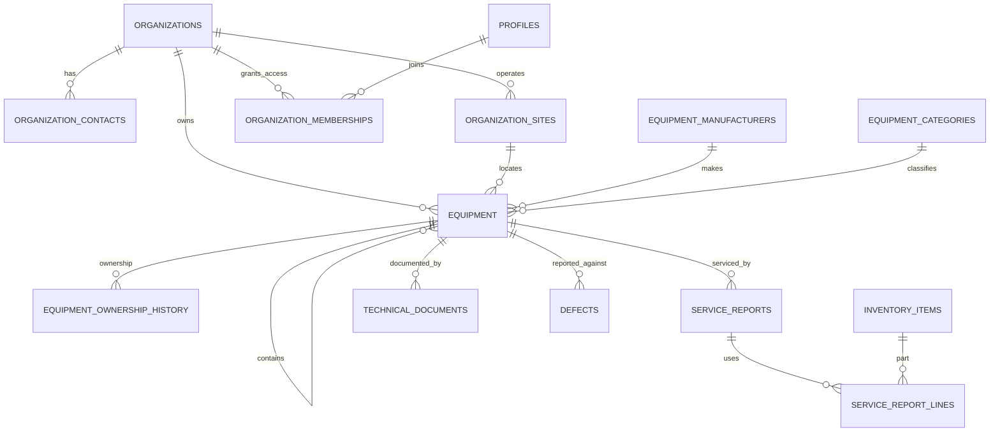

# Customer and Equipment Register

## Existing prototype and app state

The standalone service sheet prototype remains preserved at `outputs/Heavy-Transport-Service-Sheets.html`. The React application keeps service sheets, inventory, and files as independent modules. Its hosted shell currently authenticates staff but deliberately does not connect operational records to Supabase. Service sheet and stock data are still browser-local in preview. This milestone adds a local-preview customer and equipment screen and an additive database migration; it does not enable customer accounts or load customer data.

Customer fleet equipment is a separate register from Hydraroll's stocked parts. Equipment has a durable Hydraroll asset ID and belongs to a customer organisation and site. Parts used on service reports continue to reference the existing inventory catalogue and stock movement ledger.

## Proposed module architecture

```text
src/modules/
  customers/                 Customer directory, contacts and sites (next extraction)
  equipment/
    EquipmentRegister.tsx    Register, local preview forms, profile overview
    repository.ts            Future interface: list/create/update via Supabase
  service-sheets/             Existing inspection UI; later equipment linking
  inventory/                  Existing parts catalogue and stock workflow
  files/                      Existing local file screen; later protected storage
src/lib/supabase/              Authenticated Supabase client and future repositories
supabase/migrations/           Additive schema and RLS changes
supabase/tests/                Tenant boundary, role and business-rule checks
```

The prototype implementation uses one focused screen while this flow is reviewed. Before cloud integration, move storage access behind typed repositories so React does not access Supabase directly. The browser-local preview is disposable demonstration data and is labelled as such.

## Entity relationship diagram



## Schema changes and migration

`0001_initial_schema.sql` already defines organisations, memberships, sites, equipment, ownership history, service reports, inventory, private technical documents, defects, work orders and maintenance plans. `0002_customer_equipment_register.sql` adds:

- Customer reference, internal notes and active/inactive state to organisations.
- Site purpose, active state and notes to customer sites.
- Multiple organisation contacts, with a partial unique index for one active primary contact.
- Configurable manufacturer and equipment category catalogues, seeded with Goldhofer, SCHEUERLE, FAYMONVILLE, KAMAG, Enerpac and Other, and common asset classes.
- Equipment year, customer asset number, catalogue links, configuration, axle-line count, operational status, technical notes and registration date. Existing manufacturer text remains for compatibility with existing reports and screens.
- Internal-staff policy helpers and organization/equipment read and write policies. Customer users can read their own organisation and fleet; customer admins can manage their contacts and sites; only internal managers can maintain the fleet register and catalogues.

Apply migrations to a non-production Supabase project first. The second migration is additive and leaves the first migration unchanged. The current hosted React screen remains blocked from showing local preview data to authenticated users.

## Profile navigation and integration points

The initial overview shows the durable ID, customer, site, manufacturer, model, serial, customer asset number, year, category, configuration, axle lines, status, parent asset, notes and registration date. The profile exposes planned sections for Overview, Service History, Defects / Repairs, Maintenance, Technical Files, Parts History and QR Code. Only Overview is active in this slice.

Later connections should use these existing records and rules:

- **Service sheets:** add equipment and customer foreign keys, prefill customer/equipment identity, and make approved/issued reports visible to customer members only. Keep the report's original customer organisation for historical access after an ownership change.
- **Parts history:** query service report lines by equipment and join inventory items; post stock through the existing idempotent movement ledger. Never deduct inventory from a UI-only edit.
- **Technical files:** link private storage metadata to equipment and optionally report/defect. Serve restricted files through signed URLs after RLS checks.
- **Defects:** link the report and photos to equipment. Closure and return-to-service remain separate documented decisions made by authorised staff.
- **Maintenance:** use the existing date/usage maintenance plan records and equipment meter readings; customer visibility is explicit.
- **QR:** encode a permanent app route using the durable asset ID. Scanning navigates to the profile and still requires authentication and RLS permission; the QR is not a bearer credential.

## Permission matrix for this module

| Action | Platform admin | Internal manager | Technician | Customer admin | Customer user |
|---|---|---|---|---|---|
| Read customer and fleet records | All | All assigned Hydraroll scope | All assigned Hydraroll scope | Own organisation | Own organisation |
| Create/edit customer organisation | Yes | Yes | No | Limited profile fields later | No |
| Manage contacts and operating sites | Yes | Yes | No | Own organisation | Read own |
| Create/edit equipment and parent links | Yes | Yes | No; later service updates only | No | No |
| View approved customer history | All | All assigned scope | Assigned scope | Own approved fleet records | Own approved fleet records |
| Manage manufacturer/category catalogues | Yes | Yes | No | No | No |
| View local preview records | Local demo only | Local demo only | Local demo only | Not available | Not available |

Every permission above must be enforced in Supabase RLS and tested using authenticated users from at least two customer organisations. Client-side hiding is only navigation, never access control.

## Migration plan and acceptance checks

1. Review existing schema and preserve migration `0001` and the HTML prototype.
2. Apply `0002` to a throwaway Supabase project; verify existing rows and service/inventory screens remain unchanged.
3. Test RLS with separate internal manager, technician, customer admin and customer user accounts across two customer organisations. Confirm each customer can read only its own organisation, sites, contacts, equipment and explicitly released reports/files.
4. Add typed Supabase repositories, authorization-aware customer/equipment pages and duplicate/parent-cycle validation.
5. Link service reports, defects, technical files and maintenance plans through their existing relational tables.
6. Generate printable QR labels after profile routing is stable; verify unauthenticated scans do not reveal records.
7. Load approved customer inventories only after the RLS and role tests pass.

Current first-slice acceptance: local preview can add/search a customer, register/search equipment, assign a permanent sequential preview ID, record a parent asset, and open its overview. Existing service, inventory and files modules are still separate. Cloud persistence, uploads/photos, customer portal, PDF QR labels, and cross-device sync are explicitly not in this slice.

## Decisions and risks

- **Permanent ID:** use an immutable human-readable `asset_id` for labels and search. The hosted sequence must be database-generated to avoid duplicate IDs across devices; the local preview sequence is not authoritative.
- **Identity:** manufacturer serial may be blank or reused across manufacturers; the UI currently warns against an exact serial duplicate, while the final database constraint should use manufacturer plus serial and allow legitimate exceptions.
- **Ownership:** equipment ownership history stays append-only; reports preserve the original customer visibility relationship.
- **Photos:** use private Supabase Storage and document metadata once storage policies are exercised. The local preview currently has no photo persistence.
- **Operational security:** never publish customer names, fleet lists, fault submissions or files before tenant tests pass. No secrets or service-role keys belong in Vite client code.
- **Hosting:** use the existing Vercel project and `app.hydraroll.com.au` only after the app is reviewed; this change does not alter DNS, Vercel, Supabase, GitHub or the existing website.
